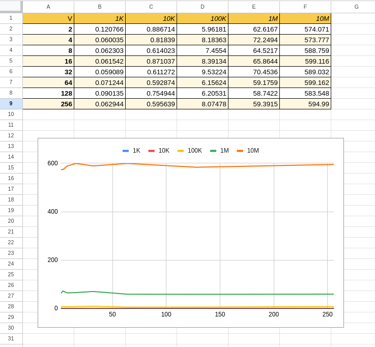

# ParallelProgramming-ArminHota

## Changes I made

**aosoa_measurement.cpp**
- Added the actual heap allocation for the AoSoA array: `new SoA_type[num_blocks]`, since num_blocks depends on len which comes from argv at runtime so a stack array wouldn't work for big sizes like 10M.
- Uncommented the fill loop lines (`AoSoA[j].R[i] = rand();` etc.) so the benchmark actually does work inside the timed region, otherwise the loop was empty and would just measure near-zero time.
- Added `delete[] AoSoA;` after the timer stops so the heap memory gets freed, but it's outside the `start`/`end` timing block so cleanup doesn't skew the measured time.

**Makefile**
- Set `TARGET_SRC = aosoa_measurement.cpp` (was commented out / blank by default), since the compile rules need to know which file to actually build. Without this it just failed with `g++: fatal error: no input files`.

## Results

Ran the benchmark for N = 1K, 10K, 100K, 1M, 10M and V = 2, 4, 8, 16, 32, 64, 128, 256 (8 vector widths x 5 array sizes = 40 runs total). Timer only wraps the fill loop, allocation and freeing aren't counted.

Looking at the graph, pretty clear N is the thing that actually drives the time, V barely moves anything. Each line (1K, 10K, 100K, 1M, 10M) stays basically flat the whole way across the V axis, just some small jitter run to run.

| N    | Time range (ms) |
|------|------------------|
| 1K   | ~0.06 – 0.12     |
| 10K  | ~0.59 – 0.89     |
| 100K | ~5.9 – 9.5       |
| 1M   | ~58.7 – 72.2     |
| 10M  | ~573.8 – 599.2   |

### Why V doesn't really do anything here

My guess is it's because the loop body is just `rand()` calls back to back for R, G, B. `rand()` isn't a cheap operation, it keeps internal state and isn't something the compiler can just vectorize away, so most of the time is probably going into that rather than into cache/memory access patterns. Also doesn't matter if V is 2 or 256, we're still walking through the array sequentially either way, just chopped into different sized chunks, so the cache access pattern doesn't really change.

Basically this workload is bottlenecked by the function call itself, not by memory, so the whole point of AoSoA (better cache usage by tiling with V) doesn't get tested properly here. If I swapped `rand()` for something like `i * 0.5` or simple index math, I think V differences would actually start showing up since the compiler could vectorize that and then memory layout would start to matter.

### Why N matters so much

Scaling looks close to linear, each 10x jump in N (1K → 10K → 100K → 1M → 10M) gives roughly a 10x jump in time too. Makes sense since it's O(n) work, just doing the same per-element stuff more times.

### Takeaway

Expected V to shift the numbers around more since tiling into vector-sized blocks is supposed to help line things up with cache lines. Doesn't really happen here though, `rand()` seems to be hiding whatever effect V would normally have. Takeaway for me is that memory layout optimizations only actually pay off when the workload is memory-bound in the first place, here it's compute-bound so changing V doesn't do much.

### Google Sheets graph
https://docs.google.com/spreadsheets/d/1GlqDYGWn8hz63ndCgI_A1sSosm3-9bYWd6hrIjF4Zc4/edit?usp=sharing

