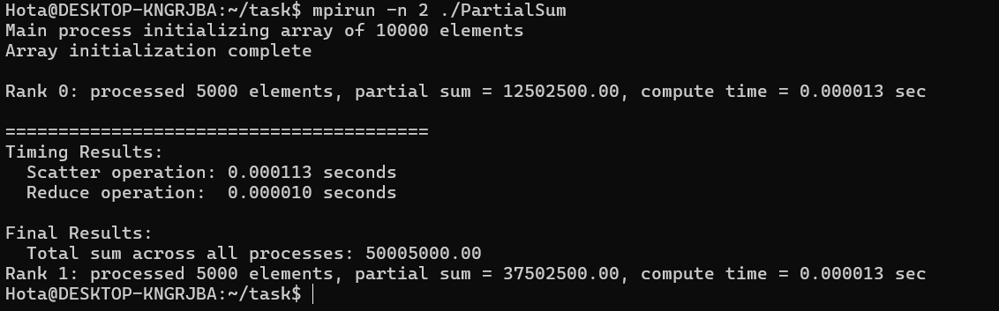
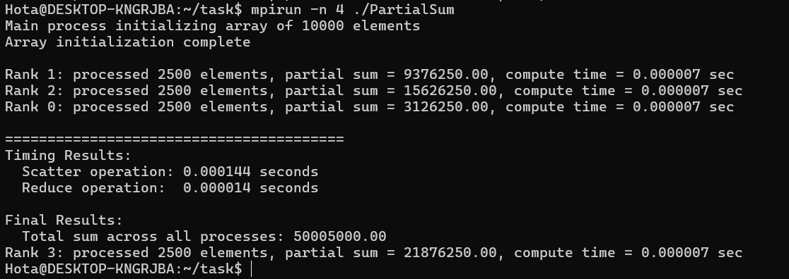
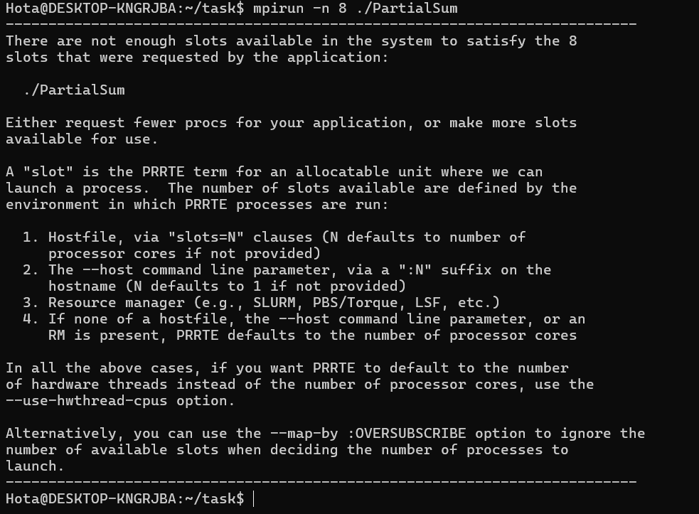

# ParallelProgramming-ArminHota

## Lab 08 - MPI partial sum

### What I did
Downloaded Example_05 from the course github and filled in the missing parts of `PartialSum.c` using the ScatterGather example from the book chapter. Ran it in WSL (Debian) on my PC:

```
make
mpirun -n 2 ./PartialSum
mpirun -n 4 ./PartialSum
mpirun -n 8 ./PartialSum
```

Rank 0 makes an array 1, 2, ..., 10000, it gets split between the processes, each one sums its part and then the parts get added together. Correct total is 50005000.

### Code I added
```c
// under "Calculate the size of array portion"
long ibegin = ncells *(rank  )/nprocs;
long iend   = ncells *(rank+1)/nprocs;
int  nsize  = (int)(iend-ibegin);

// under "Look at MPI_Allgather!"
MPI_Allgather(&nsize, 1, MPI_INT, nsizes, 1, MPI_INT, comm);

// under "Allocate local array on each process"
double *a_local = (double *)malloc(nsize * sizeof(double));

// under "Use reduce collective communication call"
MPI_Reduce(&local_sum, &total_sum, 1, MPI_DOUBLE, MPI_SUM, 0, comm);
```
The bounds split the 10000 elements so each rank gets its own range, `nsize` is how many it got, and the malloc is just for that size. Allgather is so every process has the full `nsizes` array, the `offsets` loop right after needs it. Reduce sums all the `local_sum`s into `total_sum` on rank 0.

### Explain what Scatterv does
Rank 0 cuts `a_global` into pieces and sends one to each process. `nsizes` is the size of each piece, `offsets` is where each one starts in the array. The v is for different sizes, plain Scatter only works if they're equal.

### Explain why only rank 0 needs to deallocate the resources
Only rank 0 makes `a_global`, on the others it stays `NULL` so there's nothing to free. `a_local` is on every process so everyone frees that.

### Results
Total was 50005000.00 in both runs that worked.

| Processes | Elements per rank | Compute (s) | Scatter (s) | Reduce (s) |
|---|---|---|---|---|
| 2 | 5000 | 0.000013 | 0.000113 | 0.000010 |
| 4 | 2500 | 0.000007 | 0.000144 | 0.000014 |
| 8 | - | - | - | - |

 

8 processes didn't run, MPI said "There are not enough slots available in the system". My CPU has 6 cores and Open MPI only allows one process per core by default. 

### Why the results look like this
Compute time about halves from 2 to 4 processes since each one sums half as many elements. Scatter is a lot slower than the summing itself and gets a bit slower with 4, probably because rank 0 has more processes to send to, but it's microseconds so some of it could be noise. I think 10000 elements is just too small, sending the data costs more than the work. Reduce stays small because it's only 1 number per process. Also the "Rank X" lines print out of order since every process prints on its own.

### What this means
Collective calls keep the code short, no manual Send/Recv needed. But for a small array, more processes don't really help, it would probably only pay off with a much bigger array.
